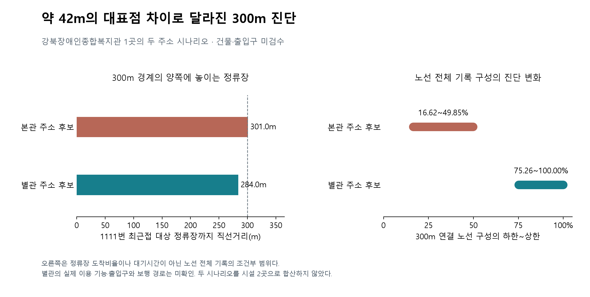

# 같은 시설도 대표 위치에 따라 진단이 달라지는 사례

> 당시 검증 과정을 보관한 메모다. 현재 결과·범위는 [최종 분석 범위](../scope-decision.md)와 [후보 공동 선정](../candidate-facility-comparison.md)을 따른다. 아래의 진행 상태는 작성 당시 기준이다.

2026-10-19. 강북장애인종합복지관은 300m·50% 기준에서 경계에 가까운 사례였다. 원본 주소에 본관 오현로 189와 별관 관련 187-6 표기가 함께 있어 두 주소의 좌표 후보를 비교했다. 이는 원래 시설 1곳의 대안적인 위치 시나리오 2개이며 시설을 2곳 추가한 분석이 아니다.

## 주소 근거와 확인 한계

[한국장애인개발원 기관 안내](https://vr.koddi.or.kr/org/org_info_view.jsp?orgCd=123456789000051&seOrgKnd1=1&seSysType=vr)에서 기관명과 본관 주소 오현로 189를 대조했다. 별관 187-6은 원본 시설 주소의 표기를 사용했으며 현재 실제 출입구와 기능을 독립적으로 확인하지 못했다. 공식 복지관 홈페이지는 웹 도구와 직접 연결에서 접속 오류가 나 오시는 길을 확인하지 못했다. 접속 실패를 기관 폐쇄나 서비스 미운영으로 해석하지 않는다.

두 주소는 카카오 주소 검색에서 유일한 서울·강북구 후보와 도로명·건물번호 일치를 확인했다. 이번 실제 추가 요청은 캐시를 재사용해 1건이었다. 두 후보의 직선 거리는 41.970m다. 건물·출입구·보행 경로의 현장 검수는 완료하지 않았다. 위치 정확도의 통계적 오차범위도 추정하지 않았다.

## 현재 데이터에서의 차이

| 항목 | 본관 주소 후보 | 별관 주소 후보 |
|---|---:|---:|
| 300m 안의 대상 노선 수 | 1 | 4 |
| 300m 안의 대상 노선 | 1124 | 145·1111·1124·1218 |
| 300m 연결 노선 중 저상 기록 비중 최댓값의 하한~상한 | 16.62~49.85% | 75.26~100% |
| 500m 연결 노선 수 | 4 | 4 |
| 500m 하한~상한 | 75.26~100% | 75.26~100% |

값은 2026-10-13~15 노선 전체 운행기록을 현재 저상 분류와 조건부로 연결한 비중이다. 해당 정류장의 도착비율이나 실제 대기시간이 아니다. 최댓값의 하한과 상한은 서로 다른 노선에서 만들어질 수 있다.

145·1111·1218번이 연결된 최근접 대상 정류장까지의 직선거리는 본관 후보에서 301.027m, 별관 후보에서 284.032m였다. 300m라는 경계 바로 바깥에 있는 정류장이 포함되는지에 따라 진단이 달라졌다. 1124번 최근접 정류장은 각각 69.100m와 97.594m였다. 이 거리는 보행 경로나 횡단 가능 여부를 반영하지 않는다.

## 이번 사례가 바꾼 해석

본관 후보의 상한이 50% 바로 아래라는 이유로 해당 시설의 서비스가 부족하다고 확정하지 않는다. 작은 대표점 변화와 반경 선택으로 범주가 바뀌었기 때문이다. 반대로 별관 후보의 값이 높다고 해서 실제 이용에 적합한 방향·목적지·승강장이 제공된다는 뜻도 아니다. 현장 확인 대상 건물과 출입구를 먼저 정해야 한다.

기존 전체 274·주소 일치 후보 237의 집계는 원래 단일 좌표 조건의 결과로 보존했다. 이번 시나리오를 덮어써 순위를 유리하게 바꾸지 않았고, 시설 수에도 추가하지 않았다. 강북 사례에는 ‘대표 위치·반경에 민감함’이라는 해석을 추가한다. 임의의 연속 가중치로 실제 수요가 검증된 것처럼 보정하지 않는다.

탄소와 접근성을 함께 개선할 교체 순위를 산출하기 위한 연료·거리 정의·실제 통행 근거는 여전히 미확인이다. 이번 결과는 원래 연구 질문의 효과 검증이 아니라 위치 입력을 확인해야 하는 이유를 보여준다.

## 재현과 산출물

주소 시나리오와 근거는 `configs/gangbuk_building_scenarios.json`에 있다. 공개 비교 결과는 `outputs/public/gangbuk_building_sensitivity.json`, 원본 응답과 후보 좌표는 Git 제외 경로에 보관했다. 두 시나리오를 실제 시설 수로 합산하지 않는 검사와 잘못된 시나리오 ID·중복·유효하지 않은 좌표의 거부 검사를 추가했다. 실행 순서는 `docs/reproduce.md`에 있다.

검증: 전체 49개 테스트 통과. 그림은 공개 비교 JSON으로 생성하고 한글 표기·축·경계선·설명 문구를 시각 검수했다.

계산 거리의 소수점 자릿수는 좌표의 측위 정확도를 보장하지 않는다. 독립 코드 검토에서 중요 지적은 없었고, 새 경로 재실행 결과가 공개 비교 JSON과 바이트 단위로 일치했다.
