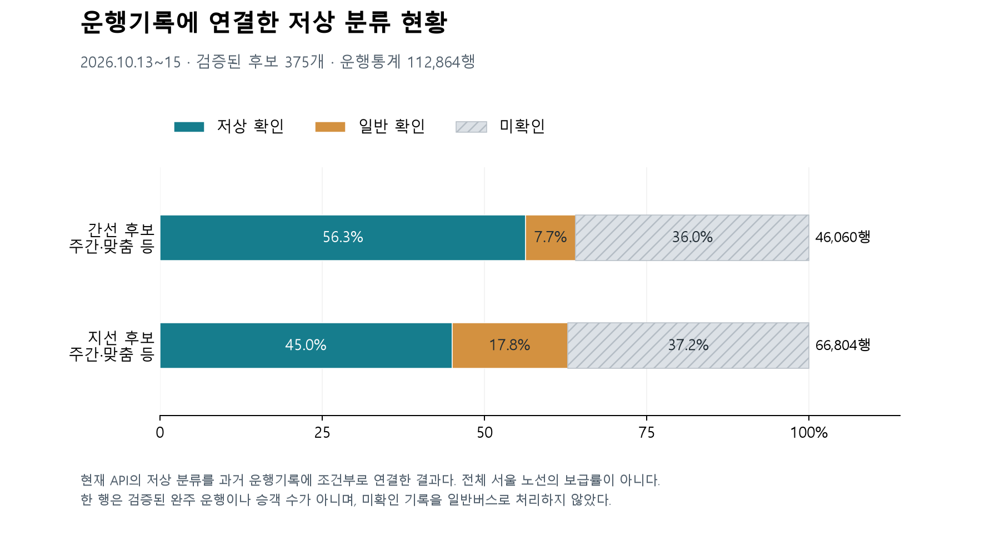
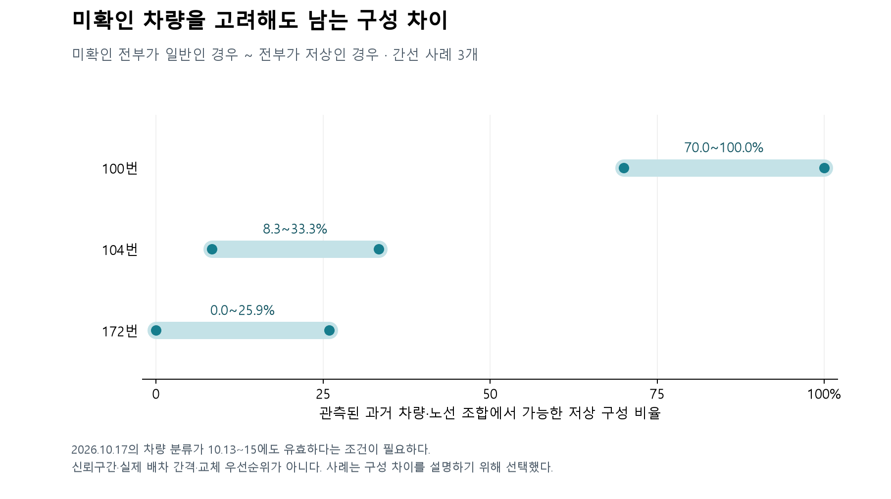
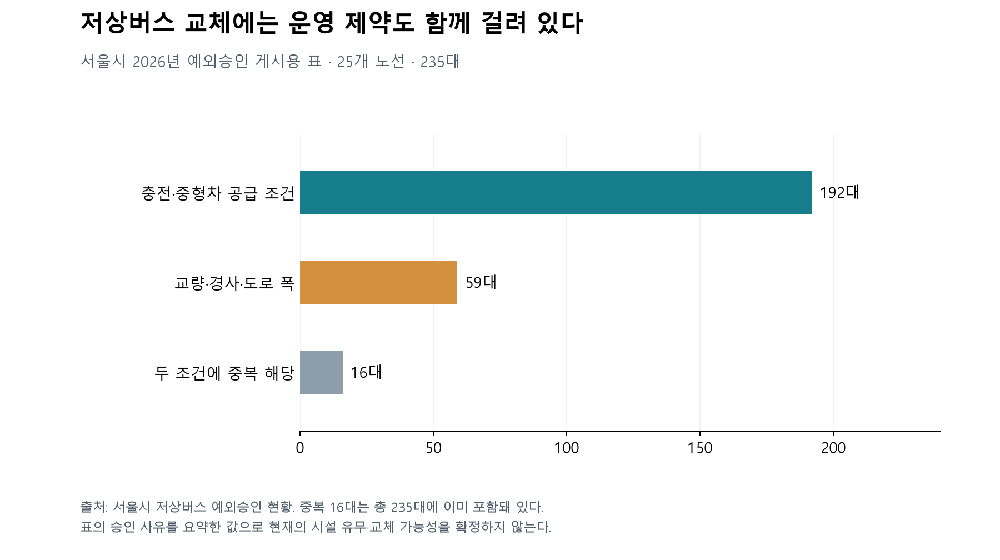
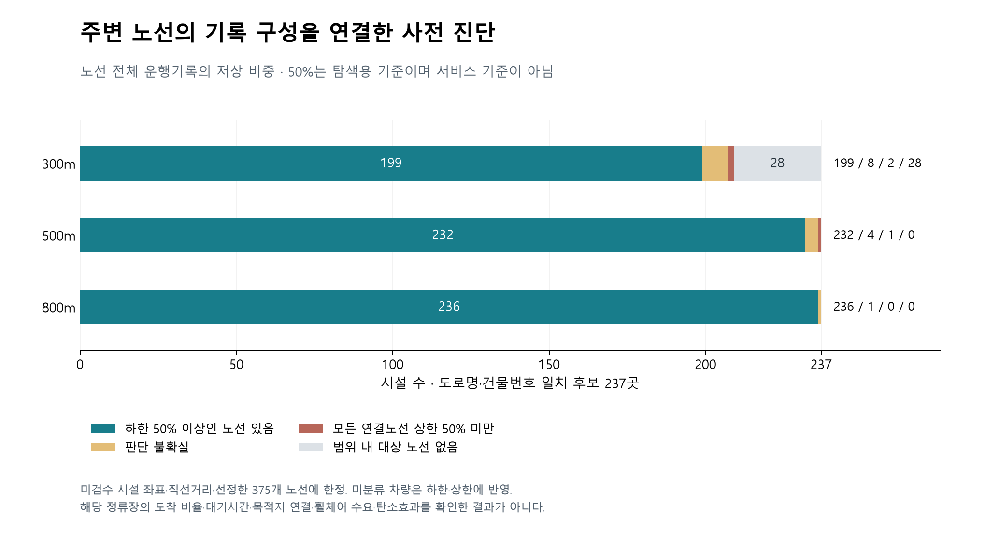

# 서울 버스의 전기저상 전환 검토를 위한 저상차량 구성과 운영 제약 분석

개인 검토용 초안, 2026-10-20. 제출용 완성본이 아니다. 현재 결과와 앞으로 검증할 내용을 구분하기 위해 작성했다. 이름·참여 동기·동의·서명은 본인이 작성한다.

## 분석 배경과 목적

버스를 친환경 차량으로 바꾸는 일과 저상버스를 늘리는 일은 함께 추진할 수 있다. 다만 같은 효과는 아니다. 기존 저상버스를 전기저상버스로 바꾸면 운행 단계의 탄소배출은 달라질 수 있지만, 저상버스를 탈 수 있는 기회가 늘어났다고 보기는 어렵다. 비저상 차량의 교체는 접근성 개선 여지가 있지만 도로와 차량 규격, 충전 조건도 맞아야 한다.

이번 연구는 노선별 저상차량 구성 차이와 관련 시설 주변의 대상 노선, 공식 운영 제약을 교차 검토한다. 미분류를 고려해도 구성 차이가 남는지와 단순한 시설·반경 분석이 어디서 흔들리는지 확인한다. 탄소중립과의 연결은 전기저상 전환이라는 정책 대상에 두며 탄소감축량·최적 교체 순위·실제 접근성 효과 산정은 범위에서 제외한다. 기존 정책이 불공정하다는 결론을 전제하지 않았다.

## 활용 데이터

| 자료 | 제공기관·플랫폼 | 활용 이유와 범위 |
|---|---|---|
| 차량 운행통계 | 서울시 BIS·T-Data | 2026-10-13~15의 노선·차량·운행기록 연결. 전체 291,637행 |
| 버스위치정보 API | 서울시·공공데이터포털 | 10/17 현재 저상 분류. 과거 시점 유효성은 추가 확인 필요 |
| 노선·차량별운행노선·정류장·경유노드 | 서울시 BIS·T-Data | 후보 검증과 생활권 분석 입력 준비 |
| 저상버스 예외승인표 | 서울시 | 도로·충전·차량 공급 제약을 교체 검토에 반영 |
| 장애인지역사회재활시설 목록 | 서울시·열린데이터광장 | 잠재 목적지의 주소 목록. 실제 통행수요로 해석하지 않음 |
| 주소 검색 API | 카카오디벨로퍼스 | 공개 시설 주소의 좌표 후보 확보. 실제 건물·출입구는 미검수 |

각 자료의 직접 URL·기준시점·이용조건은 `data/README.md`에 있다. 최종 보고서에는 해당 표를 필수 데이터 목록 양식에 맞춰 옮긴다. 파일 크기와 해시는 `data/manifest.json`에 기록했다.

## 분석 과정과 방법

원본을 보존하고 셀 내부 BOM과 공백을 읽기 단계에서 처리했다. 차량·노선 ID는 문자열로 유지했다. 현재 분류를 과거 운행통계에 붙일 때는 노선 ID와 차량 ID를 함께 사용했다. 상충하는 분류와 미확인을 일반버스로 채우지 않았다.

1월 인가현황의 노선명과 운행자료를 대조한 후보 393개 가운데, 공식 마스터의 ID·이름이 일치하고 간선·지선 유형인 375개를 현황 범위로 정했다. 전체 서울 노선의 완전한 모집단은 아니다. 날짜·노선·차량·운행순번·출발시각을 후보키로 중복을 점검했다.

과거 3일간 관측한 차량·노선 조합에서 저상 확인 수를 L, 미분류를 U, 전체를 H라 두고 가능한 구성 범위를 L/H부터 (L+U)/H로 계산했다. 미분류를 모두 일반 또는 모두 저상으로 놓아도 차이가 남는지 보는 방법이다. 현재 분류가 과거에도 유효하다는 조건이 있으며 신뢰구간은 아니다.

## AI 기술 활용

OpenAI Codex를 공개 데이터 검색·명세 확인, 수집·집계 코드 작성, 품질검사, 그림·문서 초안에 활용했다. 주요 요청은 교통약자·탄소저감 관련 공개 데이터 탐색, 저상버스 자료의 분석 가능성 검토, 확보 자료의 분석과 보고서 정리였다. 이는 실제 요청의 요약이다. 연료나 시설 좌표를 AI 추정값으로 채우지 않았다. 최종 문서에는 주요 프롬프트를 포함하고 본인이 원문·집계·해석을 검토한 상태를 정확하게 적는다.

## 현재 분석 결과

375개 후보의 운행통계는 112,864행이었다. 현재 저상 분류를 연결한 기록은 55,989행, 일반은 15,449행, 미확인은 41,426행이었다. 연결률은 기록 기준 63.3%다. 이는 차량 수 기준 연결률과 다르며, 한 행을 검증된 완주 운행이나 승객 수로 간주하지 않았다.

간선 사례인 100번의 조건부 저상 구성 범위는 70.0~100.0%, 104번은 8.3~33.3%, 172번은 0.0~25.9%였다. 100번과 104번은 미확인을 양극단으로 처리해도 범위가 겹치지 않았다. 구성 차이를 설명할 수 있는 사례지만 실제 배차 간격이나 불공정, 교체 우선순위를 입증한 것은 아니다.

예외승인 게시용 표에는 25개 노선·235대가 있었다. 수기로 구분한 도로 조건 관련 대수는 59대, 충전·중형차 공급 조건은 중복을 포함해 192대다. 두 조건에 겹치는 16대는 합계에 다시 더하지 않았다. 예외 노선 중 23개 이름이 현재 현황 범위와 일치했다. 목록에 없다는 사실이 즉시 교체 가능함을 보장하지는 않는다.

## 시설 주변 노선 구성의 사전 진단

시설 274곳 중 좌표 후보 247곳을 얻었다. 건물번호 없는 도로 좌표 2곳은 제외했고, 원본·응답 도로명과 건물번호가 일치한 237곳을 노선 구성과 연결했다. 모두 건물 위치 검수 전이다. 300/500/800m 직선거리 내 선정 노선을 모으되, 같은 노선의 정류장이 여러 개여도 한 번만 셌다.

노선 전체 기록의 저상 비중 하한·상한을 사용해 연결 노선 가운데 높은 구성 비중을 제공할 가능성이 있는지 살폈다. 500m·탐색 기준 50%에서는 하한이 기준 이상인 노선이 있는 시설 232곳, 연결된 모든 노선의 상한이 기준 미만인 시설 1곳, 미분류로 판단이 달라지는 시설 4곳이었다. 이 수치는 해당 정류장의 실제 도착비율이 아니다. 80% 기준에서는 185곳이 불확실해져 미분류와 기준 선택의 영향이 컸다.

500m·50%의 상한 미달 사례는 도봉구수어통역센터와 분석 범위의 1119번이었다. 수어통역센터가 휠체어 수요를 대변한다고 볼 수 없고, 1119번에는 충전·중형차 공급 관련 예외승인 사유가 있다. 마을버스 등 범위 밖 대안, 실제 목적지와 방향도 미확인이다. 따라서 교통 취약지나 교체 최우선 노선으로 확정하지 않았다. 시설 근처에 낮은 비중 노선이 있다는 사실과 모든 이용 대안이 부족하다는 주장은 구분해야 한다.

시설 종류별 분모를 다시 점검했다. 복지관은 원본 58곳 중 46곳, 주간이용시설은 144곳 중 133곳이 주소 일치 후보로 연결됐다. 복지관 후보 46곳은 500m 안에 하한 50% 이상인 노선이 있었지만 실제 목적지·정류장 방향·보행 접근성은 미확인이다. 연결률이 유형마다 다르고 시설 종류가 곧 휠체어 수요를 뜻하지 않으므로 전체 시설을 같은 수요 가중치로 사용하지 않았다.

강북장애인종합복지관은 원본 주소에 본관·별관 표기가 함께 있었다. 두 주소의 좌표 후보는 약 42m 떨어졌지만, 한 정류장까지의 거리가 본관 기준 301.0m·별관 기준 284.0m로 달라져 300m 진단 범주가 바뀌었다. 원래 집계는 유지하고 대표점·반경에 민감한 사례로 표시했다. 건물과 출입구 검수 없이 작은 경계 차이를 접근성 격차나 교체 우선순위로 확정하지 않는다.

## 정책 검토 방향과 기대효과

친환경 도입 실적과 저상 운행의 증가를 구분해 보고할 필요가 있다. 기존 저상차량을 대체하는 전환과 비저상차량을 대체하는 전환을 나눠야 두 목표의 증분을 확인할 수 있다.

저상 공급이 적다는 사실만으로 교체 순위를 정하지 않는다. 예외승인 사유가 남아 있는 노선은 차량 배정과 함께 충전·도로·규격 조건을 검토해야 한다. 현재 구성 차이가 크더라도 시설 이용권과 연결되는지 확인한 뒤 후보를 좁힌다.

미분류를 제외한 단일 비율 대신 확인 범위와 미확인 규모를 함께 공개하는 방식도 필요하다. 이번 단계에서는 부분 자료를 전체 보급률로 표현하지 않고 가능한 범위를 제시했다.

이 제안의 탄소감축량, 추가 이용자 수, 대기시간 감소량은 아직 산출하지 않았다. 자료 공개와 선정 기준 개선이라는 방향을 제안한 단계다.

## 남은 분석과 한계

2026-10-20 추가 자료 확보 없이 현재 자료로 마무리하기로 결정했다. 차량·노선별 연료와 거리 정의가 확인되지 않아 탄소감축량과 동일 교체 대수 최적화는 이번 연구의 범위에서 제외한다. 추가 기관 회신은 완료 조건이 아니다. 구성 차이와 운영 제약의 분석을 현재 연구 결과로 제시한다.

시설 좌표 후보와 300/500/800m 거리·주변 노선 구성의 사전 진단은 진행했지만 건물·출입구 검수와 실제 이동 수요 분석은 남아 있다. 시설 수는 실제 통행수요나 휠체어 이용자 수를 뜻하지 않는다. 차량 분류의 과거 유효성도 확인이 필요하다.

배차 이력은 대부분 일정한 정차시간과 규칙적인 시각을 보였고 역전 기록도 있었다. 계획·생성 시각인지 실제 관측인지 확인하기 전에는 대기시간 분석에 사용하지 않았다. 3일 자료는 연간·계절·휴일을 대표하지 않는다.

## 분석도구와 참고자료

Python 3.12와 표준 라이브러리, matplotlib를 사용했다. 재현 명령은 `docs/reproduce.md`에 있다. 코드는 GitHub 저장소 TransportationData에서 관리하며 2026-10-20 사용자 승인으로 공개 전환했고 로그인 없는 분석 브랜치 README 접근을 확인했다. 원자료 확보 절차와 당시 분류 스냅샷의 재현 한계는 실행 안내에 설명했다.

핵심 출처는 서울 T-Data 운행·노선·정류장 자료, 공공데이터포털의 서울 버스위치정보조회 서비스, 서울시 버스 현황·저상버스 예외승인 현황, 서울 열린데이터광장의 장애인지역사회재활시설 목록이다. 정확한 URL은 데이터 출처표를 사용한다.

## 2026-10-21 제출 전 정리

핵심 결과는 미분류를 고려해도 남는 일부 노선의 저상차량 구성 차이다. 시설 분석은 이동 편의의 충족 여부를 판정하는 결과가 아니라 위치와 기준에 따른 불확실성을 확인하는 보조 분석으로 제시한다.

정책 제안은 기존 저상차량 대체와 비저상차량 대체를 구분한 전기저상 도입 실적 공개, 그리고 저상 구성·미확인 범위 점검 → 도로·충전·차종 제약 확인 → 시설 출입구·이동 방향·대안 노선 확인 순서의 검토 절차다. 탄소감축량과 실제 이동권 개선 효과는 산정하지 않았다.

공고를 2026-10-21 재확인했다. 접수 마감은 2026-10-22이며 본문에 시각은 명시되지 않았다.

## 추가 분석: 검토 유형과 민감도

2026-10-21. 추가 데이터 수집 없이 공개 집계로 수행했다. 3일간 노선별 기록 수를 합산했으며 차량 대수 구성과 구분한다.

| 기준 | 낮은 구성 확인형 | 운영 제약 확인형 | 정보 보완형 | 하한 충족 |
|---|---:|---:|---:|---:|
| 30% | 6 | 9 | 92 | 268 |
| 50% | 21 | 16 | 123 | 215 |
| 80% | 67 | 22 | 280 | 6 |

상한이 기준 미만이면 낮은 구성으로 분류하고 공식 예외승인 사유가 있으면 운영 제약 확인형으로 구분한다. 하한이 기준 이상이면 하한 충족, 나머지는 정보 보완형이다. 상한이 기준과 같으면 낮은 구성으로 확정하지 않는다.

세 기준 모두 낮은 구성인 노선은 15개이며 그중 9개는 공식 예외승인 사유가 있다. 기준에 따라 유형이 달라진 노선은 316개다. 모든 기준에서 유형이 같더라도 정보가 충분하다는 뜻은 아니다. 예외승인 사유가 없는 노선의 교체 가능성은 미확인이다.

안정적인 낮은 구성은 세 탐색 기준에 한정되며 교체 순위가 아니다. 30% 미만 조건이 50%, 80% 미만도 함의하므로 독립된 세 번의 검증으로 해석하지 않는다. 낮은 범위 기준에서도 결론이 남는 노선을 구분한 것이다.

세 기준 모두 낮은 구성인 노선: 103, 172, 1114, 1129, 1130, 1136, 1137, 1226, 2112, 2113, 2114, 5621, 6624, 3317, 422

위치 검수형은 강북장애인종합복지관의 별도 시설 수준 표시다. 노선 375개 집계에 더하지 않는다. 조건부 과거 분류·3일 표본·실제 도착/대기시간 미확인이라는 한계는 유지한다.

검토 조치: 낮은 구성 확인형은 차량 구성·교체계획을, 운영 제약 확인형은 도로·충전·차종 제약을, 정보 보완형은 차량 분류를 우선 확인한다. 하한 충족을 충분한 이동 편의로 해석하지 않는다.

## 우선 교체 검토 후보의 구체화

미확인 운행기록을 모두 저상으로 가정해도 비중 상한이 30% 미만이고 확보한 공식 예외승인표와 연결되지 않은 422·172·103·3317·2112·1137번을 우선 교체 검토 후보로 제안한다. 예외승인표 미연결이 교체 가능성을 보장하지는 않는다.

422번은 후보 6개 중 기록 비중 상한이 가장 낮은 20.1%이며 관측 차량은 저상 확인 0대·일반 확인 12대·미확인 3대다. 172번은 상한 24.2%, 관측 차량은 저상 확인 0대·일반 확인 20대·미확인 7대다. 두 노선을 구체적 검토 사례로 선정하고 교체계획·차령·도로·충전 조건을 확인해 일반차량의 전기저상 전환 가능성을 검토하도록 제안한다. 실제 탄소감축·수요·접근성 기준의 종합 우선순위는 아니다.
